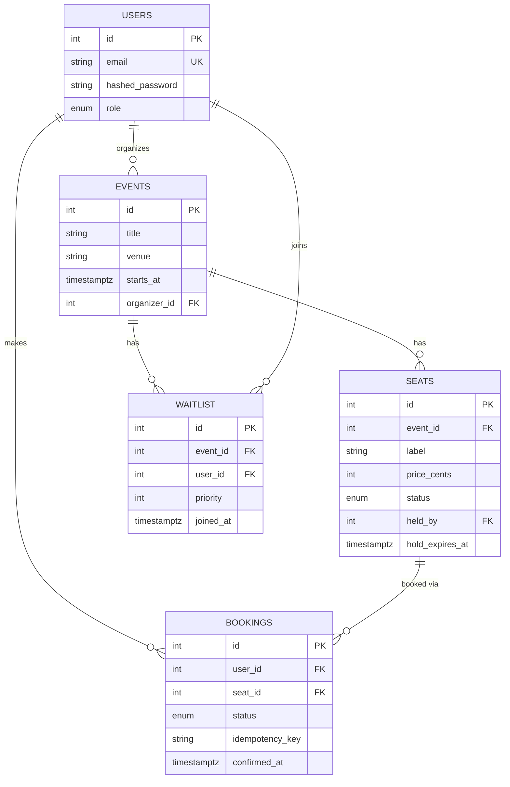

# TicketDhaka: system design

## 1. Requirements

**Functional:** browse events, see a live seat map, hold a seat for 5 minutes, pay and confirm, cancel, join a waitlist when sold out.

**Non-functional:**
- **Correctness above all:** a seat can never be sold twice.
- Reads vastly outnumber writes (people refresh the seat map constantly), so reads need a cache.
- Survive retries and duplicate requests from flaky networks.
- Degrade gracefully: if Redis is down, the app keeps working.

## 2. Data model (3NF)



**Indexes** (each matches a real query):

| Index | Serves |
| --- | --- |
| `UNIQUE(event_id, label)` on seats | no duplicate seat labels within an event |
| `(event_id, status)` on seats | "available seats for event X", seat counts |
| `(status, hold_expires_at)` on seats | the expiry sweeper's scan |
| `UNIQUE(user_id, idempotency_key)` on bookings | idempotent retries, enforced by the DB |
| `UNIQUE(event_id, user_id)` on waitlist | no duplicate waitlist entries |

## 3. The core problem: concurrent booking

**The bug in the naive version** (a read-modify-write race):

```text
A: SELECT status → available      B: SELECT status → available
A: UPDATE → held, INSERT booking   B: UPDATE → held, INSERT booking   ← double-sold
```

With the lock removed, the concurrency test produced **25 bookings for one seat**.

**Options considered:**

| Approach | How | Pros | Cons |
| --- | --- | --- | --- |
| **Pessimistic row lock** (chosen) | `SELECT ... FOR UPDATE` | Simple, always correct, the DB does the work | Requests for the *same* seat queue up |
| Optimistic locking | `UPDATE ... WHERE version = n`, retry on 0 rows | No waiting at low contention | Retry storms exactly when a seat is hot |
| Redis distributed lock | `SET seat:7 NX PX 5000` | Takes load off the DB | Two systems to keep consistent; lock expiry edge cases |
| Conditional UPDATE | `UPDATE seats SET status='held' WHERE id=7 AND status='available'` | One round trip | Harder to fold idempotency and waitlist logic into one statement |

Row locks are **per seat**, so two people booking *different* seats never block each other. Contention only happens where it has to.

**Isolation level:** the default READ COMMITTED is enough, because the explicit row lock gives us serializability *for that seat*. SERIALIZABLE for every transaction would add aborts and retries across the whole app.

## 4. Idempotency

Mobile clients retry on timeouts. The client generates a UUID per *intended* booking and sends it as `Idempotency-Key`.

1. Lock the seat row (this serializes concurrent retries of the same request).
2. If a booking with `(user, key)` already exists, return it with **200** (not a new 201).
3. Otherwise create the booking. `UNIQUE(user_id, idempotency_key)` is the final guarantee.

## 5. Hold expiry

- Seats are held for `HOLD_MINUTES` (5).
- A background sweeper runs every 15 s: `SELECT ... WHERE status='held' AND hold_expires_at < now() FOR UPDATE SKIP LOCKED`. **SKIP LOCKED** means it never blocks a user who's booking right now; it picks those seats up next time.
- **Lazy expiry as a backup:** if someone tries to hold a seat whose hold has expired but hasn't been swept yet, the hold path expires it inline. Correctness never depends on the sweeper's timing.

## 6. Waitlist (binary heap)

When a seat frees up (cancel or expiry), the waitlist entries for that event are loaded into a min-heap ordered by `(priority, joined_at)`: VIPs first, then first-come-first-served. `pop()` is O(log n). The seat is immediately held for the next person, inside the same transaction as the release, so nobody else can grab it in between.

## 7. Caching

| Layer | What | Why |
| --- | --- | --- |
| L1: in-process LRU | hash map + doubly linked list, O(1) get/put/evict, TTL | no network hop, absorbs repeat reads |
| L2: Redis | JSON values with TTL | shared across instances |

- **Write path:** every seat change → `invalidate_prefix("event:{id}:")` and the events list.
- **Staleness bound:** a TTL of 30 s (L1 15 s), so even a missed invalidation heals on its own.
- **Measured:** 184 → 544 req/s, p50 106 → 29 ms, 99.6% hit rate.
- **Failure mode:** a Redis error is logged and treated as a cache miss, so the request falls through to Postgres.

## 8. Rate limiting

A token bucket per client IP (the real IP comes from `X-Forwarded-For` behind nginx): capacity 60, refilling at 10 tokens/s. It allows bursts (opening the page fires several requests) but caps the sustained rate. Refill is computed lazily on each request, so it's O(1) with no timers. Over the limit, the client gets **429** with `Retry-After`.

## 9. Scaling to 1M users (a big concert drop)

| Bottleneck | Fix |
| --- | --- |
| Many API instances | Stateless app behind a load balancer; move the WebSocket hub to **Redis pub/sub**; run the sweeper as **one dedicated worker** |
| Read load | CDN for static assets; Redis cluster; **read replicas** for event listings |
| Write hotspot (one event, thousands of writes per second) | **Virtual waiting room / queue** (e.g. Kafka or SQS): admit N users per second to the booking page; only admitted users can hold seats |
| DB size | **Shard by event_id**: one event's seats always live together, so locks never cross shards |
| Payment latency | Async payment via webhook; the hold covers the payment window; an outbox pattern for reliable "booking confirmed" events |
| Bots | Rate limits per user and per IP, CAPTCHA at the waiting room |

## 10. What I'd add next

- Alembic migrations (currently `create_all` at startup)
- Prometheus metrics + a Grafana dashboard
- An outbox table + worker to email tickets reliably
- Multi-instance WebSockets over Redis pub/sub
