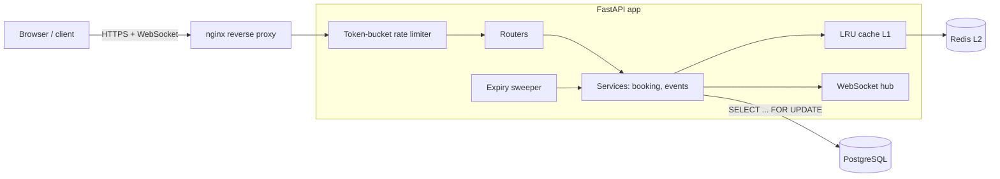

# TicketDhaka 🎟️

**Tickets for events in and around Dhaka (concerts, tech meetups, cricket and football, food fairs, theatre, comedy), built so that when 200 people grab the same seat at the same moment, exactly one of them gets it.**

[](https://github.com/Aranya07/ticketdhaka/actions)
   

**Run it:** `docker compose up --build`, then open http://localhost:8080 · **API docs:** `/docs` (admin login only)

> Open it in two browser tabs and click the same seat. One tab gets it; the other gets a 409, and its seat map updates live over WebSocket.

---

## Why this project

Dhaka has a packed events scene (Shilpakala, ICCB, Mirpur stadium, rooftop gigs in Gulshan, food fairs in Dhanmondi), and popular events sell out in minutes. Flash sales are a classic backend problem: thousands of requests hit the same few rows at the same instant, and a naive "check if free, then book" implementation double-sells seats. TicketDhaka solves this properly and measures the result.

## Features

- **Events in and around Dhaka:** 9 categories (music, tech, sports, food, theatre, comedy, workshop, festival, other) × areas (Gulshan, Dhanmondi, Mirpur, Uttara, Savar, Gazipur, Narayanganj…), with search, filters and "from ৳" pricing; past events are hidden automatically
- **No double-booking:** `SELECT ... FOR UPDATE` row locks serialize competing transactions on a seat
- **Idempotency keys:** a client retrying a request (flaky mobile network) never creates two bookings
- **Hold → pay → confirm flow:** seats are held for 5 minutes; a background sweeper frees expired holds using `SKIP LOCKED`
- **Payments with aamarPay** (bKash, Nagad, Rocket, cards; sandbox): the payment, the booking and the seat are written in one transaction; every result is verified with aamarPay's API (never trusted from the browser) and applied idempotently, so a payment is never recorded twice; a background job catches payments whose redirect never came back; late payments and cancellations are queued for refund. Without credentials a built-in demo gateway is used
- **Priority waitlist:** a binary heap (VIP first, then FIFO); a cancelled seat goes straight to the next person
- **Two-level cache:** a hand-written O(1) **LRU cache** (hash map + doubly linked list) in front of Redis
- **Rate limiting:** a hand-written **token-bucket** limiter middleware (429 + `Retry-After`)
- **Live seat map** over WebSockets
- **JWT auth** with access and refresh tokens, and role-based access (attendee / organizer / admin)
- **Admin dashboard** (`/admin`): live stats, every booking, seat release, event management, role management
- **Dockerized**: one `docker compose up --build` runs the whole stack (API image + nginx + Postgres + Redis) on localhost
- Structured JSON logs with request IDs, a `/health` endpoint, nginx reverse proxy config, Docker Compose, GitHub Actions CI

## Results

| What | Result |
| --- | --- |
| 200 concurrent holds on 1 seat | **exactly 1 success, 199 × 409**: [`tests/test_concurrency.py`](tests/test_concurrency.py) |
| Same test with the row lock removed | **25 "successful" bookings of one seat**: the bug the lock prevents |
| Read throughput, cache off → LRU cache | **184 → 544 req/s (~3×)** |
| p50 latency, cache off → LRU cache | **106 ms → 29 ms (−73%)** |
| Cache hit rate under load | **99.6%** |

<sub>Measured with `bench/bench_latency.py` (2,000 requests, concurrency 20) on a 2-vCPU machine with local Postgres. Re-run it on your own hardware: `CACHE_ENABLED=false` vs `true`.</sub>

## Architecture



Layered design: **routers** (HTTP only) → **services** (business rules, transactions) → **models** (SQLAlchemy). The cache follows the **Strategy pattern** (`Cache` interface → `InMemoryLRUCache` | `RedisCache` | `NullCache`), so the services never know which backend they're using.

## How the booking lock works

```text
Request A                         Request B
BEGIN                             BEGIN
SELECT seat 7 FOR UPDATE  ✅ lock  SELECT seat 7 FOR UPDATE  ⏳ waits...
status = available → held
INSERT booking
COMMIT  (lock released)  ───────▶  ✅ lock acquired, reads status = held
                                  → 409 Conflict
```

The full reasoning, alternatives (optimistic locking, Redis locks) and how this scales to millions of users are in **[DESIGN.md](DESIGN.md)**.

## Run it locally

```bash
git clone https://github.com/Aranya07/ticketdhaka && cd ticketdhaka
docker compose up --build        # API + Postgres + Redis + nginx
open http://localhost:8080       # demo login: demo@ticketdhaka.dev / demo12345
```

Admin (`/admin` and the API docs at `/docs`): `admin@local.dev` / `admin12345` unless you set `ADMIN_EMAIL` / `ADMIN_PASSWORD`.

For development (app on your machine, Postgres + Redis in Docker): `bash scripts/setup.sh`. It works with Docker Desktop or Docker Engine inside WSL, and moves Postgres to port 5433 if a local PostgreSQL already uses 5432.

### Payments with aamarPay (sandbox, free)

aamarPay is a Bangladeshi gateway (bKash, Nagad, Rocket, cards). Its sandbox has public test credentials, so there's nothing to sign up for:

1. In `.env` set `AAMARPAY_STORE_ID=aamarpaytest` and `AAMARPAY_SIGNATURE_KEY=dbb74894e82415a2f7ff0ec3a97e4183`, then restart the app.
2. Hold a seat and click Pay: you go to aamarPay's sandbox page, pay with any test method, and come back to a confirmed booking.
3. The server checks every payment with aamarPay's transaction API before confirming, and the expiry sweeper re-checks unfinished ones, so closing the tab after paying still books the seat.

aamarPay has no refund API: when a paid booking is cancelled, or a payment arrives after the hold ran out, the payment is marked `refund_pending` and the admin refunds it from the aamarPay merchant panel. No real money moves in the sandbox. Leave the credentials empty to use the demo gateway instead.

**Tests:** `pytest -q` (needs a Postgres database called `ticketdhaka_test`). **Load test:** `k6 run bench/k6_booking_rush.js`.

## API

| Method | Path | Description |
| --- | --- | --- |
| POST | `/auth/register`, `/auth/login`, `/auth/refresh` | JWT access + refresh tokens |
| GET | `/events?category=&area=&q=&limit=&offset=` | Upcoming events with filters, search and live seat counts (cached) |
| GET | `/events/meta` | Filter options: categories, plus areas with upcoming events |
| POST | `/events` | Create an event + seat grid (organizers only) |
| GET | `/events/{id}/seats` | Seat map (cached, invalidated on every change) |
| POST | `/events/{id}/seats/{seat_id}/hold` | Hold a seat for 5 min. Requires an `Idempotency-Key` header |
| POST | `/bookings/{id}/checkout` | Start an aamarPay payment for a held seat; returns `payment_url` |
| GET/POST | `/payments/aamarpay/return?tran_id=` | Where aamarPay sends the browser back; verifies with aamarPay, then confirms (idempotent) |
| POST | `/bookings/{id}/confirm` | Demo gateway payment (bKash / Nagad / card) → confirmed. Off when aamarPay is set up |
| POST | `/bookings/{id}/cancel` | Cancel; a paid booking is refunded, and the seat goes to the waitlist if anyone is on it |
| POST | `/events/{id}/waitlist` | Join the waitlist (only when sold out) |
| GET | `/me/bookings` | Your bookings |
| WS | `/ws/events/{id}` | Live seat updates |
| GET | `/admin/stats` · `/admin/users` · `/admin/bookings` | **Admin only:** platform stats, users, all bookings |
| PATCH | `/admin/users/{id}/role` | **Admin only:** promote a user to organizer/admin |
| POST / DELETE | `/admin/seats/{id}/release` · `/admin/events/{id}` | **Admin only:** force-free a stuck seat, delete an event |
| POST | `/admin/demo-events` | **Admin only:** load the Dhaka demo catalog (13 events; skips any already there) |

### Roles

- **attendee:** everyone who signs up. Registration can't choose a role (that would be privilege escalation).
- **organizer:** creates events. Only an admin can grant it.
- **admin:** the owner. Created at startup from the `ADMIN_EMAIL` / `ADMIN_PASSWORD` secrets (never in git). It has a dashboard at **`/admin`** with live stats, every booking, one-click seat release and role management.

## What I learned and the trade-offs

- **Pessimistic vs optimistic locking:** row locks are simple and correct for hot seats; optimistic locking (a version column) has less waiting at low contention but causes retry storms in a flash sale.
- **Where to put the idempotency check:** checking *after* taking the seat lock serializes duplicate retries; the unique constraint is the last line of defence.
- **Cache invalidation:** every seat state change invalidates that event's keys, and a short TTL bounds staleness if an invalidation is ever missed.
- **Single instance today:** the LRU cache, WebSocket hub and sweeper live in-process. To scale out: Redis pub/sub for WebSockets and the sweeper as its own worker (see DESIGN.md).

## Tech

Python 3.12 · FastAPI · SQLAlchemy 2 · PostgreSQL 16 · Redis 7 · PyJWT + bcrypt · WebSockets · pytest · k6 · Docker · nginx · GitHub Actions

<sub>Formerly named SeatLock. Renamed to avoid clashing with an unrelated product.</sub>
